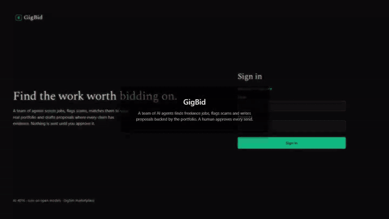

# GigBid

GigBid is a multi-agent copilot for freelancers. A team of LangGraph agents finds jobs, flags
scams, checks every requirement against the freelancer's real portfolio, prices the bid, and
drafts a proposal in which every claim is backed by evidence. A human approves, edits or
rejects every proposal, message and Connects spend before anything leaves the system.

Live app: https://gigbid-vkhw.onrender.com (reviewer login in the private submission comment)

R&D report: [docs/REPORT.pdf](docs/REPORT.pdf) (source: [docs/REPORT.md](docs/REPORT.md))

Portfolio MCP server, usable on its own with any portfolio file: [mcp_servers/portfolio/README.md](mcp_servers/portfolio/README.md)



## What it does

1. The Scout pulls new jobs from saved searches on a schedule and drops duplicates.
2. The Job Analyst, Risk Assessor and Fit Matcher run in parallel. They produce a typed job spec,
   a scam and client-quality report, and a table that matches each requirement to portfolio evidence.
3. Decide bids, watches or skips, with reasons. Pricing sets a price from market statistics.
4. The Writer drafts from evidence only and claim verification removes anything unsupported. The
   Critic can send the draft back twice, and the Compliance Guard applies the platform rules.
5. The graph pauses for human approval (a LangGraph `interrupt`), and the pause survives restarts.
6. When a client answers, the Client Liaison drafts a reply or interview slots for approval.

## Architecture

```
React + Vite UI  ->  FastAPI (SSE streaming)  ->  LangGraph bid graph + conversation graph
                                                  Postgres checkpointer + memory store (Neon)
                          MCP over HTTP (bearer auth, per-agent tool allowlists)
           Portfolio MCP (RAG)     Marketplace MCP -> port -> GigSim | Upwork (stub)     Workspace MCP
```

Graphs rendered from code: `docs/images/bid_graph.mmd`, `docs/images/conversation_graph.mmd`.
Details and the reason each agent exists: [docs/ARCHITECTURE.md](docs/ARCHITECTURE.md).

## Results

Every number below comes from a file in `evals/results/`. Data is synthetic (see
[docs/DATA_CARD.md](docs/DATA_CARD.md)). Models: gpt-oss-20b for cheap nodes and gpt-oss-120b for
the Writer and Critic, both open-weight, served by Groq. Embeddings and reranker run on CPU.

### End to end on 51 dev jobs (`decision_eval.json`)

| Metric | Value |
|---|---|
| Bid or skip F1 (precision / recall) | 0.957 (1.0 / 0.917) |
| Scam detection precision / recall | 0.60 / 1.00 |
| Price inside the fair band | 84.8% |
| Unsupported claims per proposal, before / after verification | 0.152 / 0 |
| GigSim client reply rate | 60.6% |
| Seconds per job, p50 / p95 | 20.6 / 116.5 |
| Cost per job analysed / per proposal | $0.0011 / $0.0015 |

### RAG variants (`rag_eval.json`, 36 jobs with gold evidence)

| Variant | Recall@5 | MRR | nDCG@10 | p95 ms | Unsupported claims per proposal | Judge score | GigSim reply rate | Cost per proposal |
|---|---|---|---|---|---|---|---|---|
| V0 naive dense (shipped for evidence) | 0.898 | 1.0 | 0.955 | 18 | 0.152 before, 0 after | 4.6 / 5 | 60.6% | $0.0015 |
| V1 requirement decomposition | 0.803 | 0.857 | 0.847 | 40 | | | | |
| V2 hybrid BM25 + dense (RRF) | 0.836 | 0.917 | 0.851 | 44 | | | | |
| V3 cross-encoder rerank | 0.810 | 0.794 | 0.783 | 1268 | | | | |
| V8 corrective loop (shipped for the fit matrix) | 0.854 | 0.884 | 0.854 | 1678 | | | | |

Embeddings are `BAAI/bge-small-en-v1.5`. The first run used `nomic-embed-text-v1.5` (V0 Recall@5
0.947, `rag_eval_nomic.json`), which was replaced because it does not fit in the free host's 512 MB
of memory. The proposal-level columns (claims, judge, reply rate, cost) were measured with nomic.

The pre-registered hypothesis (decomposition plus hybrid adds 15 points) was rejected: it lost
6 to 15 points depending on the embedding model, and the ablation shows decomposition was the cause. V8 is kept for fit scoring because
it refuses evidence for 100% of poor-fit requirements and only 2% of good-fit ones.
Decision record: [docs/adr/001-rag-design.md](docs/adr/001-rag-design.md).

### Is the multi-agent design worth it? (`rnd_c_compare.json`, 12 jobs, gpt-oss-120b)

| System | Bid or skip accuracy | Scams skipped | Unsupported claims per proposal | Reply rate | Tokens per job |
|---|---|---|---|---|---|
| One ReAct agent with all tools | 0.75 | 3/3 | 0.5 | 66.7% | 3,799 |
| Prebuilt supervisor (researcher + writer) | 0.833 | 3/3 | 1.29 | 85.7% (6 of 7) | 2,231 (undercounted, see below) |
| GigBid hand-built graph | 1.00 | 3/3 | 0 | 66.7% | 6,062 |

GigBid is the only system that never sent an unsupported claim and the only one that got every
bid or skip right; it pays for that with more tokens (claim checking and the Critic loop). The
supervisor's higher reply rate rests on 7 proposals, too few to separate from the others. Its token
count covers only the messages left in the final state (each worker hands back just its last
message), so the true cost is higher. One supervisor job needed 3 attempts because gpt-oss wrote a
malformed tool name; the first two supervisor runs failed on every job because `create_supervisor`
drops the structured answer unless a state schema is passed (fixed in `rnd_c_compare.py`).

### Other experiments

| Experiment | Result | File |
|---|---|---|
| Tool granularity (40 tasks, gpt-oss-20b) | fine tools 97.5% tool / 97.5% argument accuracy; coarse 82.5% / 55%, 2.4x fewer tokens; rewritten descriptions no change | `rnd_a_tools.json` |
| Prompt injection (planted jobs and client messages) | attack success 0% with and without defences; the model ignored these attacks on its own | `injection_eval.json` |
| A/B test of proposal strategies (extension X2) | reply rate 60% (A) vs 69% (B), p = 0.47, not significant | `ab_test.json` |
| Judge calibration (30 human labels, gpt-oss-20b judge) | Cohen's kappa 0.23 (19/30 agree): the judge separates good from generic proposals (4.6 vs 1.0 out of 5) but is too lenient on subtle problems, so human labels and claim verification are the trusted quality measures | `judge_calibration.json` |
| Platform policy update (change request) | 1 file changed (`gigsim/policy.yaml`, 6 lines added, 3 changed), no code changes; on 3 jobs the cost rose by 2 Connects and the required AI disclosure was present every time (added by the Compliance Guard) | `change_request.json` |

### Traces

Public LangSmith traces (made by `scripts/make_traces.py`, links in `evals/results/trace_links.json`):

1. [Scam job skipped before any writing](https://eu.smith.langchain.com/public/9658d6fb-b18d-484b-ad71-2329b764e776/r) (job-002)
2. [Good job: parallel analysis, Writer, claim check, Critic sends it back once, Compliance, pause for approval](https://eu.smith.langchain.com/public/0ab2f0fc-ca53-4a62-9aca-d37c584b724e/r) (job-006)
3. [After a restart: a new runtime resumes the paused thread, the human approves, it is submitted once](https://eu.smith.langchain.com/public/b6c10839-f9be-4e47-be7a-cfea81347f75/r) (job-006)

## Run it

```bash
python -m venv .venv && .venv/Scripts/pip install -e ".[dev]"      # bin/ on Linux and macOS
cd apps/web && npm ci && npm run build && cd ../..
cp .env.example .env                                                # add GROQ_API_KEY; DATABASE_URL optional
python scripts/run_all.py                                           # http://localhost:8000
```

Tests: `pytest -q` (unit, integration, contract), `cd apps/web && npx playwright test` (5 browser
tests). Evaluations: `make eval` or the runners in `evals/runners/`. Operations, degraded mode and
deployment: [docs/RUNBOOK.md](docs/RUNBOOK.md). MCP tools: [docs/TOOLS.md](docs/TOOLS.md).

## Repository map

| Folder | Contents |
|---|---|
| `agent/` | graphs, nodes, prompts, memory, model config, MCP client, marketplace port |
| `rag/` | ingestion, index, variants V0 to V8, retriever factory, claim verification |
| `mcp_servers/` | Portfolio, Marketplace (with GigSim and Upwork adapters), Workspace |
| `apps/api`, `apps/web` | FastAPI backend, React + TypeScript frontend, Playwright tests |
| `gigsim/` | the marketplace simulator used for development and evaluation |
| `evals/` | datasets, runners and every results file the report cites |
| `docs/` | architecture, data card, tools, runbook, decision records, AI usage |

## Pinned versions

Python 3.11 (Docker) or 3.13 (local): langgraph 1.2.20, langgraph-checkpoint-postgres 3.2.0,
langchain-core 1.7.7, langchain-openai 1.7.4, langchain-mcp-adapters 0.3.2, mcp 1.30.0,
fastapi 0.162.2, fastembed 0.9.1, psycopg 3.3.8, langgraph-supervisor 0.0.31. Web: React 18,
Vite 5, TypeScript 5, Playwright 1.65. Full list: `requirements.lock.txt`, `apps/web/package-lock.json`.

## Resume bullet

Built GigBid, a LangGraph multi-agent freelancer copilot with 3 MCP servers and human approval
gates; on 51 evaluation jobs it reached 0.957 bid/skip F1, caught 100% of scams, cut unsupported
proposal claims from 0.15 to 0 per proposal, and drafted proposals for $0.0015 each on open models.
