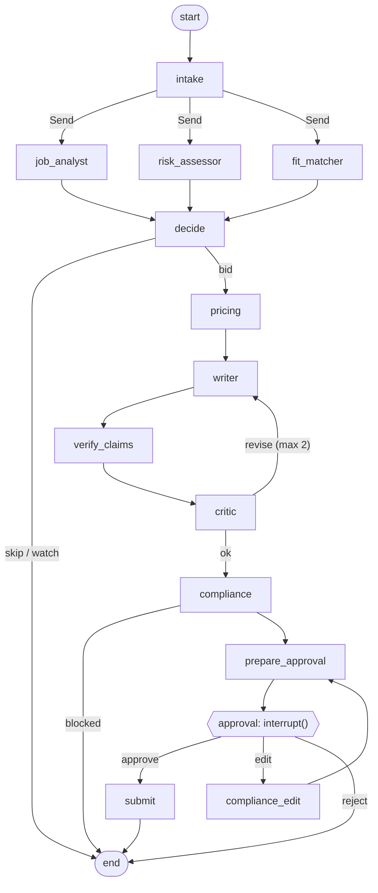

# Architecture

GigBid is a team of LangGraph agents that find freelance jobs, judge them, write grounded
proposals and handle client replies, with **a human approving every proposal, message and
Connects spend**. Agents touch the outside world only through MCP tools.

```
 Browser (React + Vite + TS) ──HTTP/SSE──> FastAPI (apps/api)
                                              │  background tasks (never inside a request)
                                              v
                         LangGraph: bid graph + conversation graph (agent/)
                         checkpointer + store: Postgres (Neon) / SQLite locally
                                              │  MCP over Streamable HTTP, bearer auth,
                                              │  per-agent tool allowlists (agent/mcp_client.py)
              ┌───────────────────────────────┼───────────────────────────────┐
              v                               v                               v
     Portfolio MCP (read)           Marketplace MCP (read+write)        Workspace MCP
     RAG over the portfolio         marketplace PORT (one interface)    calendar + email drafts
     (rag/: V0 + V8)                 ├─ GigSimAdapter ──> GigSim         (local mock)
                                     └─ UpworkLiveAdapter ──> Upwork MCP (stub)
```

## The bid graph (one thread per job, `bid:<user>:<job>`)

Rendered from code: [`images/bid_graph.mmd`](images/bid_graph.mmd) (`python -m agent.graphs.render`).



Every edge goes through `guard()`: it stops on a final status and diverts to
`needs_attention` when the step budget (30) or token budget (40k) is exceeded.

## The conversation graph (one thread per client conversation, `conv:<user>:<thread>`)

`load_thread → classify → plan_reply → draft_reply → reply_compliance → prepare_reply_approval →
reply_approval (interrupt) → send` ([`images/conversation_graph.mmd`](images/conversation_graph.mmd)).
Rules decide what to do (answer, accept/counter at the floor, offer calendar slots, refuse to
leave the platform); the model only words it.

## Why each agent exists

| Agent | Why it exists | Model / tools |
|---|---|---|
| Scout | find new jobs, drop duplicates and reposts, never re-process a job | no LLM · `search_jobs` |
| Job Analyst | turn a messy post into a typed `JobSpec`; flag injected instructions | gpt-oss-20b · none |
| Risk Assessor | protect Connects and the user from scams | rules + gpt-oss-20b · `get_client_history`, `get_policy` |
| Fit Matcher | prove (or fail to prove) each requirement from the portfolio | no LLM · `map_requirements` (RAG V8) |
| Decide | bid / watch / skip with reasons, autonomy setting | rules |
| Pricing Strategist | a price inside the budget, above the floor, from market stats; Connects worth it? | rules · `market_stats`, `get_connects_balance`, `get_policy` |
| Proposal Writer | grounded cover letter + screening answers | gpt-oss-120b · `search_evidence`, `get_case_study`, `get_policy` |
| Claim verification | remove claims the evidence does not support | reranker (rag/verify.py) |
| Critic | grounding, personalisation, length, screening; sends back at most twice | rules + gpt-oss-120b |
| Compliance Guard | enforce the policy pack: no contact details, guarantees, off-platform talk; required statements | rules |
| Client Liaison | classify replies, draft answers / slots, keep the pipeline current | 20b + 120b · thread tools + workspace |

Cheap, frequent nodes use the small model; the Writer and Critic use the strong one; four
agents need no model at all (cheaper, faster, deterministic). All models are set in
`agent/config.yaml`.

## State, execution trace and long-term memory (kept apart on purpose)

| | What | Where |
|---|---|---|
| **State** | what this job/conversation needs now (spec, risk, fit, draft, approval...) | `agent/state.py`, checkpointed after every step |
| **Execution trace** | every tool name, arguments, result, trace id | MCP audit log (`data/processed/audit/*.jsonl`, PII masked) + LangSmith traces |
| **Long-term memory** | only PROMOTED knowledge: style rules from edits (≥2 edits), outcome summaries (≥3 results) | LangGraph store, `agent/memory/` |

Parallel branches write through reducers (`operator.add` for steps/usage/critiques, last-write
for status). Agents exchange Pydantic hand-offs (`agent/handoffs.py`), never free text.

## Durability, failures, degraded mode

- **Postgres checkpointer**: a proposal waiting for approval survives a crash; resume submits
  exactly once (idempotency keys derived from the thread + draft id). History can be replayed
  from any checkpoint (`/api/jobs/{id}/history`, `runtime.replay_from`).
- **Per-node** timeouts, retries and a dead-letter status; LLM fallback model for cheap nodes;
  polite pacing when rate-limited (wait and retry, never fail).
- **Marketplace down**: the job pauses at its checkpoint with status `queued`, the UI shows a
  banner, a recovery loop resumes it when health returns; `scripts/run_all.py` restarts a killed server.

## Data stores

| Store | Holds |
|---|---|
| Postgres (Neon) | LangGraph checkpoints + store (users, job summaries, memory, ledger) |
| GigSim SQLite | the simulator's proposals, messages, Connects |
| Marketplace MCP SQLite | proposal drafts awaiting approval (idempotent) |
| NumPy vectors per persona | the RAG index (cached by content hash, incremental) |
